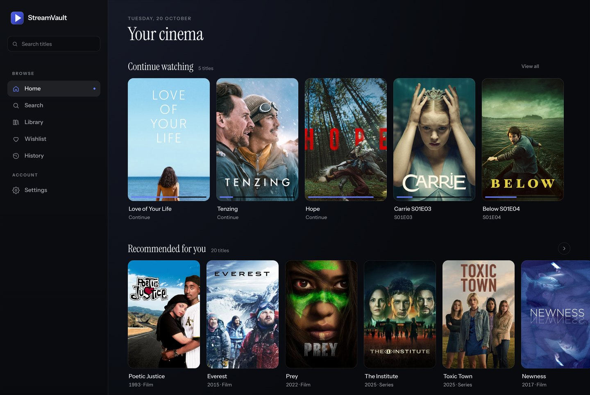
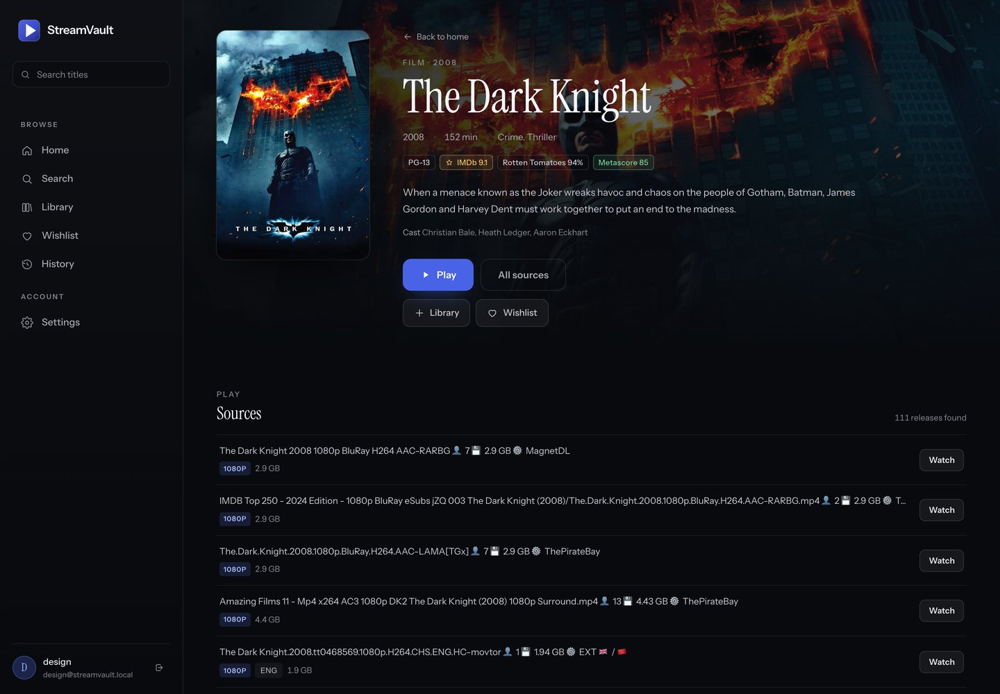
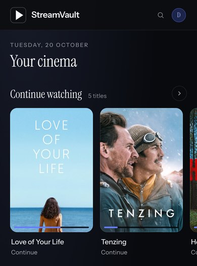

<p align="center">
  
</p>

<h1 align="center">StreamVault</h1>

<p align="center">
  <strong>Your own cinema, in a browser tab.</strong><br>
  Self-hosted movies and TV with direct play, smart transcoding, and no media library to store.
</p>

<p align="center">
  <a href="https://github.com/vitobotta/streamvault/actions/workflows/ci.yml"></a>
  <a href="https://github.com/vitobotta/streamvault/releases/latest"></a>
  <a href="https://github.com/vitobotta/streamvault/blob/main/LICENSE"></a>
  <a href="https://github.com/vitobotta/streamvault/stargazers"></a>
  <a href="https://github.com/vitobotta/streamvault/discussions"></a>
</p>

<p align="center">
  <a href="https://streamvault.page"><strong>streamvault.page</strong></a> ·
  <a href="#why-streamvault">Why StreamVault</a> ·
  <a href="#how-it-compares">Comparisons</a> ·
  <a href="#features">Features</a> ·
  <a href="#quick-start">Quick start</a> ·
  <a href="#sponsor">Sponsor</a>
</p>

<p align="center">
  <a href="https://github.com/sponsors/vitobotta"></a>
</p>

> **StreamVault is built and maintained by one developer.**
> No company, no venture money, no paid tier. If it has earned a place in your setup, sponsoring is the most direct way to fund the next release.
>
> **[Become a sponsor](https://github.com/sponsors/vitobotta)** · from $1/month

---

## Why StreamVault

Most media setups ask you to choose between a pile of moving parts and a client app on every device. StreamVault is one Docker stack and one URL.

- **Nothing to download, nothing to store.** Streams are resolved on demand. No terabytes of media, no download queue, no files to rename or deduplicate.
- **One URL for every screen.** Phone, tablet, laptop, TV browser. No app to install, no addon to configure per device, no platform support matrix.
- **It picks the cheapest way to play.** Direct play when the browser can handle the source, a low-cost remux when it nearly can, and a full transcode only when it cannot. Older hardware plays modern files.
- **A real household setup.** Separate accounts with their own library, history, wishlist, and language preferences. Child accounts with age limits and a lock password.
- **Private by design.** Your RealDebrid key is encrypted at rest, never written to logs, and never sent to the browser. No analytics, no third-party telemetry.
- **Open source, MIT.** Read it, change it, self-host it. There is no account with the author and no feature held back for a paid plan.

## How it compares

|  | **StreamVault** | **Plex + Sonarr/Radarr** | **Stremio** |
|---|---|---|---|
| **Time to first movie** | One Compose stack, about ten minutes | Hours: indexers, download client, paths, naming, storage | Install the app, then add sources |
| **Media storage** | None. Streamed on demand | Full copies, often several terabytes | None |
| **Software to install** | A browser | Plex app on every platform | Stremio app on every platform |
| **Transcoding** | Built in, automatic, per stream | Plex Pass for hardware transcoding | Depends on the device's codec support |
| **Accounts** | Per-user library, history, and languages | Managed users | One library per account |
| **Child controls** | Age caps, fail-closed, lock password | Rating limits per managed user | Not built in |
| **Running cost** | Server plus RealDebrid | Server, disk, Plex Pass, indexers, VPN | RealDebrid only |

Different tools for different jobs. If you want a permanent offline library, a download stack is the right choice. StreamVault is for watching now, in a browser, with as little machinery as possible.

## Screenshots



<sub>Continue watching, recommendations, your library and wishlist on one page.</sub>



<sub>Title pages carry the backdrop, ratings and every source, with the best cached one ready to play.</sub>

<p align="center">
  <br>
  <sub>On a phone: the same rails, with a floating bottom bar.</sub>
</p>

## Features

### Find something to watch

- **Search** any movie or show, with posters, plots, cast, genres, and age ratings.
- **Ratings** from IMDb, Rotten Tomatoes, and Metacritic on every title.
- **Popular and trending** rows for films and TV, refreshed from live metadata.
- **Recommendations** based on what you have watched, using TMDB's collaborative filtering.
- **Rich title pages** with backdrop, overview, cast, ratings, seasons, and every available source.

### Play it properly

- **Three playback paths**: native direct play, video remux, and full transcode. StreamVault picks the lightest one the source and browser can support.
- **Audio track selection** when a release carries multiple languages.
- **Subtitle support** for embedded text tracks and image formats (PGS, VobSub), with SubDL as a fallback when nothing is embedded. Bitmap subtitles are burned in because browsers cannot render them.
- **Timestamp correction** keeps audio and video aligned after a resume, a seek, or a recovery.
- **Automatic stall recovery** reconnects the stream and preserves the playhead before asking you to intervene.
- **iPhone support** through an HLS fallback for Safari, which lacks the MSE support the main player relies on.
- **Keyboard controls**, playback speed, volume, and precise seeking.
- **Resume and progress tracking** saved every few seconds and shared across sessions.

### Watch TV like TV

- **Season and episode browser** with air dates, overviews, and per-episode progress.
- **Auto-advance** to the next episode when one finishes.
- **Skip to the next episode** at a closing-credits chapter, or in the final seconds when no chapter exists. It is offered, never forced: no countdown, no automatic skip.

### A household, not a single login

- **Separate accounts**, each with its own library, wishlist, watch history, and recommendations.
- **Child accounts** limited by age rating, resolved from OMDB and TMDB certifications and failing closed when a rating cannot be found.
- **Child lock** for turning restrictions off or changing the age limit.
- **Language preferences**: 17 audio languages, filtered and sorted per user, with a default track.
- **Sign-ups disabled by default**, so a public instance stays private until you open it.

### Built to be left alone

- **One Compose stack**: Rails, PostgreSQL, and Solid Queue in a single deployment.
- **Encrypted secrets**: RealDebrid keys are encrypted at rest with Active Record Encryption.
- **Health endpoint** at `/up` for uptime checks.
- **No analytics and no call-home.** The only outbound requests are to the metadata, stream, and subtitle services listed above.
- **MIT licensed**, with no telemetry and no paid edition.

## How it works

```
Browser
  │
  ▼
StreamVault (Rails)
  ├──► Cinemeta / OMDB   metadata, artwork, ratings
  ├──► Torrentio / Comet available streams
  ├──► RealDebrid        resolves the selected stream
  └──► Playback
       ├── direct proxy  compatible media, no encoder
       └── FFmpeg        remux or transcode, subtitle burn-in, HLS
```

1. **Search.** StreamVault queries metadata catalogues and returns matching titles with posters, ratings, and plots.
2. **Pick a source.** Each title lists available streams with quality, size, and audio languages, sorted by your preferences.
3. **Press play.** StreamVault resolves the source through RealDebrid, probes its tracks, and chooses direct play, remux, or transcode.
4. **Keep watching.** Progress is saved as you watch, so the same title resumes on any device you sign in from.

StreamVault does not ship a catalogue and does not keep a media library. Bytes pass through the server on demand and may be buffered while proxied or transcoded.

## What it connects to

| Service | Role | Needed |
|---|---|---|
| [RealDebrid](https://real-debrid.com) | Resolves the selected stream into a direct link | Required |
| [OMDB](https://www.omdbapi.com/apikey.aspx) | IMDb, Rotten Tomatoes, and Metacritic ratings | Required, free key |
| [Torrentio](https://torrentio.strem.fun) | Finds available streams | Default provider |
| [Comet](proxy/comet) | Self-hosted alternative stream provider | Optional |
| [Cinemeta](https://v3-cinemeta.strem.io) | Titles, posters, plots, episodes | Built in, no key |
| [TMDB](https://www.themoviedb.org/settings/api) | Recommendations from your watch history | Optional, free key |
| [SubDL](https://subdl.com/panel/api) | External subtitles when none are embedded | Optional, free key |

## Quick start

**You need:** a Linux server or VPS with Docker and Docker Compose, a [RealDebrid](https://real-debrid.com) account, and a free [OMDB API key](https://www.omdbapi.com/apikey.aspx). A 2-core, 2 GB machine is enough for direct play; 4 cores and 4 GB or more keeps transcoding comfortable.

```bash
git clone https://github.com/vitobotta/streamvault.git
cd streamvault
cp .env.example .env
openssl rand -hex 64   # SECRET_KEY_BASE
openssl rand -hex 32   # run separately for each encryption key and POSTGRES_PASSWORD
${EDITOR:-nano} .env
docker compose up -d --build
```

Set at minimum `SECRET_KEY_BASE`, the three `ACTIVE_RECORD_ENCRYPTION_*` values, `POSTGRES_PASSWORD`, and `OMDB_API_KEY`. Set `APP_DOMAIN` for a public deployment. The app is then on `http://localhost:3000` unless you changed `PORT`.

### Create your first user

Sign-ups are disabled by default. Create the first account from the Rails console:

```bash
docker compose exec web bin/rails c
> password = SecureRandom.base58(24)
> User.create!(email: "you@example.com", password: password, password_confirmation: password)
> puts password
```

Save the password, sign in, and change it from Settings if you like. To allow self-registration, set `ENABLE_SIGNUPS=true` and restart.

### Add your RealDebrid key

Open **Settings**, paste your RealDebrid API key from [real-debrid.com/apitoken](https://real-debrid.com/apitoken), and save. StreamVault verifies it immediately. The key is encrypted at rest and never appears in logs.

### Updating

```bash
git pull
docker compose up -d --build
```

The database lives in `./data` and survives rebuilds. Containers restart on crash and on boot (`restart: unless-stopped`); make sure Docker itself starts at boot with `sudo systemctl enable docker`.

## Configuration

| Variable | Purpose | Default |
|---|---|---|
| `SECRET_KEY_BASE` | Session cookies | required |
| `ACTIVE_RECORD_ENCRYPTION_*` | Encrypt stored API keys | required |
| `POSTGRES_PASSWORD` | Database password | required |
| `OMDB_API_KEY` | Ratings metadata | required |
| `APP_DOMAIN` | Public host name | empty |
| `ENABLE_SIGNUPS` | Allow self-registration | `false` |
| `STREAM_PROVIDER` | `torrentio`, `comet`, or `auto` | `torrentio` |
| `TMDB_READ_ACCESS_TOKEN` | Recommendations | empty |
| `SUBDL_API_KEY` | External subtitle fallback | empty |

The full list, provider modes, Cloudflare proxy setups, and reverse proxy notes are in [docs/CONFIGURATION.md](docs/CONFIGURATION.md).

## Troubleshooting

| Symptom | First thing to check |
|---|---|
| No streams, 403s, or intermittent provider failures | Your server IP may be blocked by Cloudflare. See [the proxy guide](docs/CONFIGURATION.md#proxies-when-you-might-need-one) |
| Playback buffers during transcoding | CPU saturation in the web logs. Try a 1080p H.264 source before 4K, HEVC, or AV1 |
| A resumed stream is CPU-heavy | Expected: a non-zero seek may re-encode to keep audio and video aligned |
| Sign-in does not persist behind a proxy | HTTPS on the public URL, and the proxy must forward the original scheme and host |

Logs and health:

```bash
docker compose ps
docker compose logs --tail=200 -f web
curl -I http://localhost:${PORT:-3000}/up
```

More in [docs/CONFIGURATION.md](docs/CONFIGURATION.md#troubleshooting).

## Sponsor

StreamVault is one person's work, built in the evenings and at weekends. Sponsorship pays for the time that goes into it:

- **Fixes land sooner.** Playback bugs, device quirks, and provider changes are worked through in order of impact.
- **The app keeps up.** RealDebrid, Torrentio, Cinemeta, and the metadata APIs change without warning. Keeping up is ongoing work, not a one-off.
- **No lock-in stays possible.** MIT license, self-hosted, no account with the author. Sponsorship is what makes that sustainable instead of a paid tier.

<a href="https://github.com/sponsors/vitobotta"></a>

From $1/month. Sponsoring funds maintenance and development, not content.

**Other ways to help, all free:** star the repo so other self-hosters find it, report bugs with logs and your setup, answer a question in [Discussions](https://github.com/vitobotta/streamvault/discussions), or send a pull request.

## Who am I

I'm Vito Botta, a developer in Finland. I build web applications by day and maintain a few open source projects in the time around it, including [hetzner-k3s](https://github.com/vitobotta/hetzner-k3s). StreamVault is what I wanted for my own movie nights: a proper cinema interface, one server, and nothing to babysit.

More at [vitobotta.com](https://vitobotta.com).

## Contributing

Contributions are welcome. Development setup, the test suites, architecture notes, CI, and the release process are in [docs/DEVELOPMENT.md](docs/DEVELOPMENT.md).

For a bug report, include your deployment type, the relevant log lines, and what you were playing. For a playback problem, the server log and the browser console together are worth more than either alone.

## Disclaimer and responsible use

StreamVault is a **general-purpose media client**. Like a web browser or a BitTorrent client, it is neutral about what its operator chooses to access. The repository does not include or publish copyrighted media, and it ships no pre-configured list of pirated material.

**The author does not endorse, encourage, or support the use of StreamVault to access copyrighted content without proper authorisation.** Whoever runs an instance is responsible for what it accesses and for ensuring they have the right to access it. StreamVault is intended for:

- Public domain films and media
- Creative Commons and open-licensed content
- Your own media
- Any other content you are legally entitled to watch

The software is provided as-is, for personal use, with no warranty. The author accepts no responsibility for how an instance is used.

## License

MIT. See [LICENSE](LICENSE).
